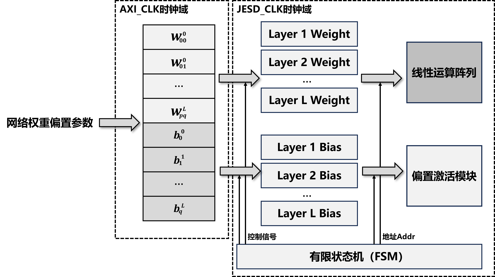
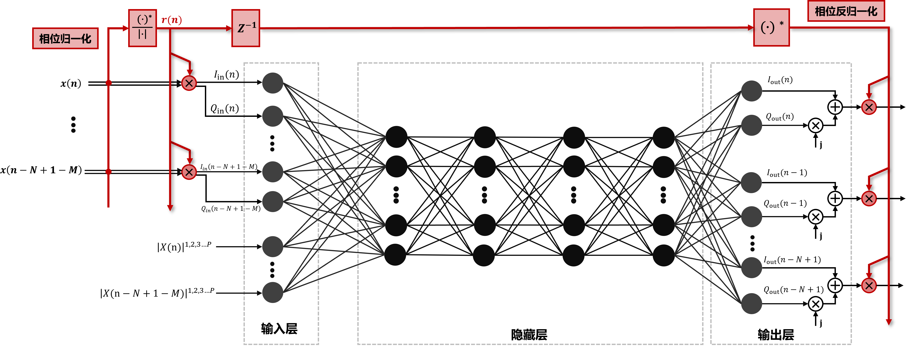

# FPGA_PRVTDNN_by-Xu_V-git_polyphase_on-board

用于对本科毕设的vivado代码进行版本管理

## **一、各部分设计的相应解释**

### 1.参数加载模块

参数加载的核心逻辑可以用下面这张图表示，网络的权重偏置参数由外部输入信号`input   [31:0]    coeff_i`输入，首先输入给内部的寄存器`    (* ram_style = "block" *) reg [31:0] coeff_data [0:COEFF_WORDS-1];`



```Verilog
    // 外部写入: coeff_addr_i 作为写地址 (0..COEFF_WORDS-1), coeff_i 为32位数据
    // 注意这里的时钟是慢速时钟AXI，和后面的高速时钟clk不一样
    always @(posedge AXI_clk_i) 
    begin
        if(coeff_en_i == 1)
        begin
          if (coeff_addr_i < COEFF_WORDS)
            coeff_data[coeff_addr_i] <= coeff_i;
        end
    end
```

待`coeff_i`输入结束，参数先全部存放在`coeff_data`中，再由`coeff_data`分发至各层的权重偏置注入接口`hl1_inWt_top`和`hl1_inBias`（参数分发的开启由`load_start`信号决定，参数写入`coeff_data`完成后才会拉高`load_start`），该参数分发的过程由状态机控制，`LD_HL1_WT_RD`（读取某一行的权重参数）、`LD_HL1_WT_PUSH`（将某一行的权重推送至`hl1_inWt_top`）、`LD_HL1_BIAS_RD`（读取并推送偏置参数），这里指出`LD_HL1_WT_RD`和`LD_HL1_WT_PUSH`也就是权重参数的读取和推送会执行多次（权重矩阵有多行，一次只能推送一行，而偏置矩阵只有一行所以不涉及多次读取和推送），涉及状态机的反复跳转。

> **至于为什么设置"外界参数先存入`coeff_data`，再分发至各层的权重偏置注入接口"：**

时钟域隔离：外部通过 `AXI_clk_i` 写入，而网络加载和计算处于 `clk` 域。`coeff_data` 作为中间参数存储，并依靠`load_start`信号，使两个过程解耦。

状态机：是为了把“多端口读取需求”降为“单端口顺序读取”。如果直接让所有层、所有 PE 同时从 `coeff_data` 取权重/偏置，综合器看到的会是大量并发读端口。例如第一层一次要面向 $16 × 45$ 个权重位置，而单个 BRAM 通常只有有限端口（典型为双端口），无法天然支持这种大量独立读取。

这里当时李哲师兄采用的是FIFO结构来解决跨时钟域的问题，采用FIFO和本方案的区别或者优势是，**FIFO支持跨时钟域的同时读写**，而我的这个方案需要等`coeff_data`全部写完成，也就是要先写入完成才能进行数据的读取和分发。

**本版本暂时不尝试FIFO，待后续有时间再考虑FIFO的结构。**

### 2.输入预处理模块`preprocess.v`



`preprocess.v` 是 PRVTDNN 的相位归一化特征预处理模块。它每拍并行接收 4 个复数采样，维护历史采样窗口，并为后续全连接网络生成幅度、相位归一化及多项式特征。
`preprocess.v`输出为`feat_flat`（多相输入+引入幅度项）和`rk_re_flat`、`rk_im_flat`（相位归一化）。

#### 多相输入+引入幅度项

`feat_flat`：包含对当前时刻的N输入采样，$x(n),x(n-1),...,x(n-N)$，以及对考虑记忆深度的历史输入采样$x(n-N-1),x(n-N-2),...,x(n-N-M+1)$，所以总计的复数输入项个数为：$n-(n-N-M+1)+1=N+M$个，当前工程宏定义为 $M=5$、$N\_POLY=4$，因此每拍特征窗口有 $9$个复数样本：$TAP\_NUM=M+N\_POLY=5+4=9$

> 注：这里其实有点没有很严谨考虑，至少以当下我对`记忆深度`这个点的理解而言，我觉得有点不妥，在单项输入的时候考虑记忆深度这个问题是从$x(n)$一直采样到$x(n-M+1)$，这样采样深度为$M$，但对于多相输入$x(n),x(n-1),...,x(n-N)$，一直采样到$x(n-N-M+1)$实际上是考虑$x(n-N)$的$M$的记忆深度，但对于$x(n)$而言记忆深度就达到了$N+M$。

同时还包含幅度项$|X(n)|,|X(n)|^2,...,|X(n)|^p,...,|X(n-N-M+1)|,|X(n-N-M+1)|^2,...,|X(n-N-M+1)|^p$，本项目中设置的 $P$ 为 $3$ 。

所以`feat_flat`的结构如下：

```Verilog
    parameter M          = `M,
    parameter N_POLY     = `N_POLY,
    parameter TAP_NUM    = M + N_POLY,
    parameter FEAT_DIM   = 5 * TAP_NUM,
  
	output reg signed [FEAT_DIM*DATA_WIDTH-1:0] feat_flat,
  
    // 输出特征排列 (当前 45 维):
//   feat[ 0.. 8]: Re(x(n-k)/|x(n-k)|), k=0..8
//   feat[ 9..17]: Im(x(n-k)/|x(n-k)|), k=0..8
//   feat[18..26]: |x(n-k)|,            k=0..8
//   feat[27..35]: |x(n-k)|^2,          k=0..8
//   feat[36..44]: |x(n-k)|^3,          k=0..8
```

#### 相位归一化原理以及实现

**相位归一化的原文：[ieeexplore.ieee.org/document/10176354](https://ieeexplore.ieee.org/document/10176354/)**

相位归一化是：对每个待处理时刻 $ (k)$，以当前样本 $x(k)$ 的相位作为参考，将该时刻及其记忆抽头整体旋转到“当前样本相位为零”的坐标系。

$$
x(k)=|x(k)|e^{j\theta(k)}
$$

归一化因子为：

$$
r(k)=\frac{x^*(k)}{|x(k)|}=e^{-j\theta(k)}
$$

然后用同一个 $r(k)$ 乘以整个延迟窗口：

$$
\mathbf X(k)=r(k)[x(k),x(k-1),\ldots,x(k-M)]
$$

因此当前样本变为：

$$
r(k)x(k)=|x(k)|
$$

它是纯实数，虚部为零；而历史样本仍保留相对于当前样本的相对相位：

$$
r(k)x(k-m)=|x(k-m)|e^{j[\theta(k-m)-\theta(k)]}
$$

网络输出的是这个归一化坐标系中的复数结果$Y_I+jY_Q$。最后乘以：

$$
r^*(k)=\frac{x(k)}{|x(k)|}=e^{j\theta(k)}
$$

恢复到原始绝对相位坐标系：

$$
\hat y(k)=r^*(k)\,[Y_I(k)+jY_Q(k)]
$$

**相位归一化为什么能提高性能：**

普通实值 RVTDNN 将 I/Q 视为二维平面上的不同坐标，必须分别学习同一种 PA 非线性在所有绝对相位下的映射。相位归一化后，**这些等价的旋转情形被折叠到一个参考相位，网络只需学习一次。**降低模型复杂度、训练样本需求和参数相关性，从而在同等网络规模下获得更低误差。

**相位归一化的代码实现是依赖cordic.v文件**

首先是获取归一化因子 $r(k)=\frac{x^*(k)}{|x(k)|}=e^{-j\theta(k)}$ ，本质是将向量 $x(n)$ 通过多次旋转使其 $y_i\rightarrow0$ 。在数字电路中可以使用多次旋转来实现这一点，用一串固定微旋转近似任意旋转。第 $(i)$ 次微旋转的角度是：

$$
\alpha_i=\arctan(2^{-i})
$$

因为乘以 $2^{-i}$ 可直接用算术右移实现，所以每级仅需加减法和移位。

旋转模式为了使剩余角度 $z_i$ 逼近零，采用：

$$
x_{i+1}=x_i-\sigma_i y_i2^{-i}
$$

$$
y_{i+1}=y_i+\sigma_i x_i2^{-i}
$$

$$
z_{i+1}=z_i-\sigma_i\arctan(2^{-i})
$$

其中 $\sigma_i$ 由 `z_pipe[i]` 的符号决定。向量模式则依据 $y_i$ 的符号选择旋转方向，使：

$$
y_i\rightarrow0
$$

最终得到：

$$
x_{\rm final}\approx K\sqrt{x^2+y^2},
\qquad z_{\rm final}\approx\operatorname{atan2}(y,x)
$$

14 次迭代带来固定增益：

$$
K=\prod_{i=0}^{13}\sqrt{1+2^{-2i}}\approx1.6468
$$

所以模块末尾以 Q1.14 常数 `9949` 乘以$ 1/K\approx0.6073$，修正幅度与旋转坐标的尺度。

> **这里注意，在本版本的多相网络的相位归一化其实是有问题的，**在本网络中，$N=4$ ,$M=5$。
> 相位归一化的输入应该是 $x(n),x(n-1),...,x(n-3),...,x(n-8)$，
> 按照论文的思路，相位因子应该计算 $x(n),x(n-1),...,x(n-3)$ 对应的 $r(k),r(k-1),...r(k-3)$，而 $ x(n-4)$ 对应的因子仍然是 $r(k)$，，以此类推 $x(n-5)$ 对应 $r(k-1)$，$x(n-6)$ 对应 $r(k-2)$，$x(n-7)$ 对应 $r(k-3)$，$x(n-8)$ 对应 $r(k-1)$。这么考虑之后，其实再深入想一想这个记忆深度 $M=5$ 其实也有点问题，在多相网络结构中，输入 $x(n)$ 的延迟项实质上是 $x(n-4)$，那么 $x(n),x(n-1),...,x(n-3),...,x(n-8)$的这个记忆深度其实是 $M=1$ 或者 $2$，毕竟 $x(n-8)$ 相较于 $x(n)$ 是延迟两次
>
> 当时考虑输入设置为 $x(n),x(n-1),...,x(n-3),...,x(n-8)$，是因为想到多相的同一窗口输入$x(n),...,x(n-3)$，如果记忆深度为$5$，那么最深也就到$x(n-8)$，但这里就有个漏洞没有正确意识到延迟项不是$-1$而是$-4$。
